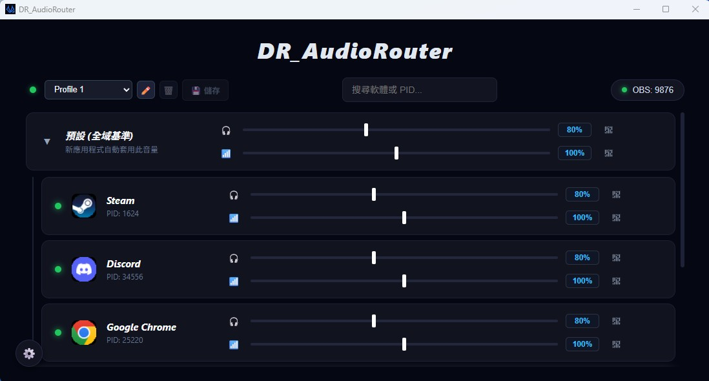

# DR_AudioRouter 🎧

<p align="center">
  
</p>

<p align="center">
  <b>專為競技 FPS 與實況打造的輕量化、零虛擬驅動獨立音訊路由器與 DSP 聽音辨位強化工具</b>
</p>

<p align="center">
  
</p>

<p align="center">
  
  
  
  
</p>

---

## 📌 為什麼選擇 DR_AudioRouter？

傳統虛擬混音器（如 Voicemeeter、SteelSeries Sonar、Wave Link）通常依賴安裝數張虛擬音效卡驅動（Kernel Audio Drivers），不僅佔用大量背景資源、容易引發系統音訊衝突，更常伴隨難以忽視的音訊延遲。

**DR_AudioRouter** 採用純粹的 **Windows WASAPI 原生進程級迴路側錄（Process-Level Loopback）** 技術：
* 🚫 **免裝核心驅動**：不修改 Windows 底層音訊堆疊，保持系統純淨穩定。
* ⚡ **超低延遲運作**：無鎖環形緩衝區（SPSC RingBuffer）搭配自研高效 DSP 核心，整體端到端延遲控制在 $5 \sim 15\text{ ms}$ 競技級水準。
* 🎚️ **真·雙軌獨立路由**：每個應用程式都能單獨調整「耳機聽感」與「OBS 串流輸出」，各自分離。
* 🎯 **FPS 專用物理增益**：內建 7 段參數型等化器（Parametric EQ）與斜率收窄小聲音動態增益（Upward Compressor），大幅拉近遠處腳步聲，開槍瞬間毫秒級退讓保護聽力。

---

## ✨ 核心特色

### 1. 獨立進程側錄與雙軌音量控制
* 自動監聽系統活躍的音訊進程（Chrome、Discord、各款競技遊戲等），並於卡片左側提供直立式即時動態電平表（dB）。
* **耳機監聽軌（Monitor）** 與 **OBS 實況軌（Stream）** 獨立控制音量（支援 $0\% \sim 500\%$ 放大）、獨立一鍵靜音。
* 未啟動的軟體也能永久記憶設定（離線軟體清單），下次開啟自動恢復；無記憶的臨時離線軟體則每 60 秒自動清理，維持版面整潔。

### 2. 7 段參數型等化器（Parametric EQ）
* 採用標準 Audio EQ Cookbook IIR 雙二階濾波器（Direct Form II transposed）。
* 即時對數座標物理響應曲線圖（$20\text{ Hz} \sim 20,000\text{ Hz}$，$-12\text{ dB} \sim +12\text{ dB}$）。
* 預設分區防碰撞邊界保護（低架、轟鳴、踏地、機關、腳步、碎物、高架），可精確手動微調 Hz、Gain 與 Q 值帶寬。

### 3. 斜率收窄小聲音動態增益（Upward Compressor）
* **遠處細節托起**：在底噪遮蔽門檻（如 $-55\text{ dBFS}$）與保護天花板（如 $-20\text{ dBFS}$）之間，越微弱的聲音補償越多（最高 $+50\text{ dB}$）。
* **保留空間立體感**：採用連續線性斜率收窄，而非死硬拉平，精確保留 15 公尺與 50 公尺的遠近層次差。
* **大聲急速退讓**：檢測到開槍或爆炸瞬間，增益在毫秒內迅速歸零，徹底消除音量拉扯的喘氣感（Pumping），保護耳膜。

### 4. OBS WebSocket 零延遲串流
* 內建超輕量 WebSocket 音訊推流伺服器（預設 Port `9876`）。
* OBS 僅需新增一個「瀏覽器來源」，即可直接透過 Web Audio API 播放音訊，免增設虛擬線路，延遲 $< 35\text{ ms}$。

### 5. 輕量常駐與多國語言
* **極低資源佔用**：單一執行檔體積小於 15 MB，閒置 CPU 佔用接近 $0.00\%$，記憶體不到 30 MB。
* **背景保活（Keep-Alive）**：瀏覽器分頁暫停再播放時瞬間出聲，告別冷卻喚醒吃音問題；視窗縮小至系統匣時自動停止前端渲染輪詢。
* **多語系即時切換**：內建繁體中文（zh-TW）與英文（en）介面，切換無需重新啟動。

### 6. 🎙️ 麥克風 4 級專業 DSP 擴充模組（預設關閉，0 資源消耗）
點擊右上角頁籤切換至「🎙️ 麥克風」即可啟用獨立收音強化鏈路，支援耳機自我監聽（無縫混入耳機輸出，不搶佔硬體）與虛擬通道轉送：
* **第 1 關：前置高通濾波器（HPF 低切）**：切除 $20 \sim 250\text{ Hz}$ 以下的冷氣低頻共鳴、桌面敲擊震動與噴麥風切氣音。
* **第 2 關：AI 智慧雜訊抑制（`nnnoiseless`）**：內建三層式調校——**① 輸入前增益（$0\% \sim 500\%$ 軟飽和防破音放大）**、**② AI 人聲判定門檻（VAD 語音信心權重，過濾非人聲與呼吸底噪）**、**③ AI 降噪深度（濾除風扇與機械鍵盤雜音比例）**。
* **第 3 關：7 段人聲參數型等化器（EQ）**：針對麥克風人聲獨立雕琢磁性厚度與唇齒咬字清晰度。
* **第 4 關：雙向動態音量平衡（小聲放大 + 黃金安全區 + 大聲縮小）**：正常說話落在「🟢 安全區下限 ～ 🟢 安全區上限」內維持 $100\%$ 原音直通不浮動；低於下限時漸進放大補償（並連動 AI 人聲權重防止沒說話時放大底噪），高於上限大吼時則沿斜率對稱壓制縮小，徹底防爆音。

---

## 🛠️ 系統架構與運作邏輯

### 麥克風 4 級 DSP 處理鏈路架構
```text
[ 實體麥克風收音 (Input) ]
      │
      ▼
[ 第 1 關：前置高通濾波器 (HPF 低切 20~250Hz) ]
      │
      ▼
[ 第 2 關：AI 智慧雜訊抑制 (輸入前增益 -> nnnoiseless RNN + VAD 門檻 -> 降噪深度混合) ]
      │
      ▼
[ 第 3 關：7 段人聲參數型等化器 (7-Band Parametric EQ) ]
      │
      ▼
[ 第 4 關：雙向動態音量平衡 (小聲放大補償 + 黃金安全區原音直通 + 大聲縮小壓制) ]
      │
      ├───────────────────────────────┐
      ▼ (轉送目標通道)                  ▼ (耳機自我監聽 - 測試用)
[ 虛擬麥克風 (VB-CABLE / Steam) ]   [ 無縫合併至實體耳機輸出線程 ]
 (供 Discord / 遊戲語音 / OBS 擷取)
```

1. **黑洞端點（Sink）**：將 Windows 預設播放裝置指定為黑洞（如虛擬音訊線路或未插線的端點），作為未接管音訊的隔離池。
2. **進程側錄**：DR_AudioRouter 透過 Windows 原生 `ActivateAudioInterfaceAsync` API 針對目標 PID 建立獨立捕捉通道。
3. **無鎖傳輸**：捕捉執行緒將 PCM 浮點音訊直接壓入 SPSC RingBuffer（`rtrb`），杜絕執行緒競爭與音訊爆音。
4. **DSP 鏈路**：耳機軌與 OBS 軌在混音迴圈中分別通過專屬的 Biquad 濾波與動態增益器。

---

## 🚀 快速上手使用教學

### 第一步：環境前置準備
1. 準備一個音訊接收裝置作為**黑洞端點**（例如安裝 VB-CABLE 的 `CABLE Input`，或使用系統中閒置的音訊輸出端點）。
2. 在 Windows 設定中，將系統 **「預設輸出裝置」** 設定為該黑洞端點。

### 第二步：設定 DR_AudioRouter
1. 開啟 `DR_AudioRouter.exe`。
2. 點擊介面左下角的 **⚙️ 設定** 圖示：
   * **黑洞接收端點**：選擇剛剛設定的黑洞裝置。
   * **實體耳機輸出**：選擇您實際插耳機的硬體設備（如 `Line (AG06/AG03)` 或耳機 DAC）。
   * **轉發延遲緩衝區**：推薦保持 `256 幀`（約 12~15 ms 平衡模式）；極致競技選手可選 `128 幀`。
3. 點擊 **「儲存並套用」**。

### 第三步：OBS 串流配置
1. 點擊 DR_AudioRouter 頂部右上角的 **「OBS: 9876」** 膠囊按鈕，自動複製串流網址（`http://127.0.0.1:9876`）。
2. 打開 OBS Studio，在來源清單新增一個 **「瀏覽器 (Browser Source)」**：
   * **URL**：貼上 `http://127.0.0.1:9876`
   * **寬度/高度**：設為 `200` × `50` 即可（此來源僅負責接收音訊）
   * 勾選 **「透過 OBS 控制音訊 (Control audio via OBS)」**
3. 點擊確定後，OBS 混音器便會出現專屬的獨立串流音軌。

### 第四步：麥克風強化與轉送設定（選用）
1. 點擊介面右上角的 **「🎙️ 麥克風」** 切換至麥克風控制面板，勾選 **「啟用麥克風處理」**。
2. **選擇收音來源與轉送目標**：
   * **🎙️ 供語音通話（Discord / 遊戲語音）使用**：可使用 Steam 內建的 `Steam Streaming Speakers / Microphone`（免額外安裝），或安裝第三方虛擬音訊驅動（如 [VB-CABLE](https://vb-audio.com/Cable/)）。將轉送目標選為對應的 **`🎙️ 虛擬麥克風通道`**，並在通訊軟體中將輸入裝置設為該虛擬麥克風即可。
   * **🎧 供 OBS 實況使用**：可直接選擇任一閒置播放裝置（`🎧`），並在 OBS 新增「音訊輸出擷取」接收。
3. 可隨時點開 **「🎧 耳機自我監聽 (測試用)」** 即時聽取調校後的降噪與 EQ 效果，調整完畢再關閉監聽並點擊左上角 **「💾 儲存」**。

---

## ❓ 常見問題 (FAQ)

#### Q1：為什麼我聽不到 Windows 的系統提示音（截圖喀嚓聲、音量調整「叮」聲）？
* **設計使然**：Windows 系統提示音由音訊核心直接合成，沒有獨立的應用程式 PID，因此會隨全域輸出沉入黑洞端點。
* **競技優勢**：在殘局 1v1 聽音辨位時，能 100% 免疫突然彈出的 USB 接觸不良音效、截圖音或 Windows 報錯提示，確保耳朵專注於戰局，實況觀眾也不會被系統雜音打擾。

#### Q2：為什麼有部分遊戲（如特戰英豪 Valorant、APEX）抓不到聲音？
* 部分搭載核心級反作弊（Anti-Cheat）的競技遊戲具有進程保護機制，請將 `DR_AudioRouter.exe` 右鍵點擊 **「內容」$\to$「相容性」$\to$ 勾選「以系統管理員身分執行此程式」** 即可完整接管。

#### Q3：開機自啟動與管理員身分衝突怎麼辦？
* 若程式勾選了「以系統管理員身分執行」，Windows 開機保護機制（UAC）會阻擋登錄檔自啟動。
* **最佳解法**：使用 Windows **「工作排程器」** 建立一項登入工作，設定觸發程序為「登入時」、動作指向執行檔並帶上 `--minimized` 參數，即可兼顧管理員權限與開機靜默啟動。

---

## 📦 自行編譯與建置 (Build)

### 需求環境
* [Rust](https://www.rust-lang.org/) (建議最新穩定版)
* [Node.js](https://nodejs.org/) (用於執行 Tauri v1 打包 CLI)
* C++ Build Tools (隨 Visual Studio 安裝之 Windows SDK)

### 本地開發
```powershell
# 1. 複製專案
git clone [https://github.com/YourUsername/DR_AudioRouter.git](https://github.com/YourUsername/DR_AudioRouter.git)
cd DR_AudioRouter

# 2. 開發模式即時運行
cargo run
```

### 正式發行版打包 (Release Build)
```powershell
# 使用 Tauri v1 CLI 進行打包 (產出純獨立執行檔與安裝包)
npx @tauri-apps/cli@1 build
```
打包完成後，可執行檔將產出於：
`target/release/dr_audiorouter.exe`

---

## 授權與版權
- Copyright © Demon Realm / Godpriest
- 麥克風降噪模組使用之第三方開源元件 `nnnoiseless` / `RNNoise` 版權聲明已內建於軟體介面與原始碼中（Copyright © Joe Neeman, Mozilla, Jean-Marc Valin, Xiph.Org Foundation, Mark Borgerding）。

## AI 協助
本插件的部分程式碼與文件經由 AI 輔助產生與修訂，最終內容均由作者審閱並整合。
